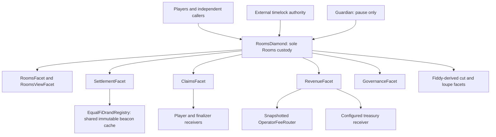

# Design Document: Rooms

## Overview

Rooms is one standalone custody Diamond, not a gaming framework. Configuration versions define approved ERC-20 games with 2–24 equally selectable rooms and a fixed ticket supply across all rooms. Multiple configurations can operate concurrently, but each configuration has at most one nonterminal round. A round opens with a paid entry and commits its future deadline beacon. Sales close on sellout or at the original deadline, whichever comes first; an early sellout atomically selects its own future beacon. Ticket prices increase across four time epochs at 1.00x/1.25x/1.50x/1.75x base price, while every ticket retains equal prize weight. Settlement is permissionless. A populated winning room creates per-ticket claims; an empty one leaves its pot for that configuration's next round. Actual entry receipts initially split 50% player pot, 20% Operators, and 30% treasury before the configurable settlement reward.

Status: accepted implementation design accompanying [requirements.md](requirements.md) and [tasks.md](tasks.md). API and storage sketches define the implementation target; validation evidence is recorded separately as work is completed. Live deployment and signing are outside this delivery.

### Key Design Decisions

1. **Reuse Fiddy's Diamond code:** retain its dispatch, selector bookkeeping, authority, loupe, and finalization mechanisms. Use Rooms-specific application namespaces and independent custody. Validates: Requirements 1.1–1.6, 16.1–16.7.
2. **Fiddy-style per-configuration lifecycle:** paid permissionless opening, immutable snapshots, one active round per configuration, global capacity, sellout-or-deadline close without a separate close transaction, and no refunds. Four time epochs increase ticket price while retaining equal prize weight. Validates: Requirements 2.1–2.8, 4.1–4.7, 5.1–5.7, 6.1–6.7, 7.6–7.8.
3. **Approved ERC-20s, simple nominal transfers:** SafeERC20, CEI, and the shared guard; no FoT/rebase accommodation or transfer-delta verification. Admission and continued behavior are explicit trust assumptions. Validates: Requirements 3.1–3.8, 20.1–20.5.
4. **Simple successor pot:** settlement leaves a pending amount keyed by configuration; the next paid opening consumes it. There is no cross-configuration pool, keeper-driven rollover migration, or global settlement order. Validates: Requirements 9.1–9.8, 18.1–18.8.
5. **Aggregate allocation and per-ticket payout:** allocate receipts once, divide the player pot once, carry division remainder into the next pot. Wallet splitting and claim order do not change entitlement. Validates: Requirements 8.1–8.8, 10.1–10.7.
6. **Thirty-day player claims:** entitlement expires at settlement plus 30 days; anyone can reclassify the remaining liability to treasury after that boundary. Rollover and non-player liabilities do not expire. Validates: Requirements 11.1–11.7, 12.1–12.7.
7. **Keep delivery out of settlement:** winner, finalizer, treasury, and Router transfers occur independently and remain usable while paused or assets are removed. Validates: Requirements 7.5, 11.1–11.7, 13.1–13.7, 14.1–14.8, 15.1–15.6.
8. **Version external integrations:** Registry and Router changes apply to future openings only, as in Fiddy. This is not a beacon-replacement mechanism. Validates: Requirements 6.1–6.7, 17.1–17.5.

### Public source baseline

| Repository | Inspected merged main | Relevant source |
|---|---|---|
| EqualFiLabs/fiddy | `795425ef6a8830278b56b9052aa2271e92930eb3` | `src/StaticsLotteryDiamond.sol`, `src/libraries/LibDiamond.sol`, cut/loupe facets, `LotteryInit`, `LotteryFacet`, `SettlementFacet`, `ClaimsFacet`, `RevenueFacet`, `GovernanceFacet`, `docs/accounting.md`, `docs/governance.md`, `docs/randomness.md` |
| EqualFiLabs/drand-registry | `118a94d2e447055d1a47d1a13488e887aaa4a822` | `src/interfaces/IEqualFiDrandRegistry.sol`, `src/EqualFiDrandRegistry.sol`, `src/libraries/QuicknetVerifier.sol` |

Fiddy PR #22 commits the deadline draw at opening; it no longer refunds unsold rounds at timeout. Its historical testnet rehearsal predates that change, and its current docs mark the fresh deadline-draw rehearsal as pending. Neither evidence class is Rooms validation. Fiddy's pinned registry submodule and the registry repository's current main must not be assumed identical; Rooms will pin the reviewed registry dependency explicitly.

### Accepted economic decisions and release inputs

- **Settlement reward denominator:** the protocol uses BPS of gross treasury allocation, deducted only from treasury. Example: 5% tip BPS gives 1.5% of gross receipts under the 50/20/30 configuration. This denominator is accepted.
- **Payout dust:** the protocol puts indivisible per-ticket remainder into the same pending successor pot. It is deliberately not claim-order-dependent or address-count-dependent.
- **Launch inputs:** base price, ticket supply, duration, randomness delay, reward rate, asset/dependency addresses, external timelock parameters, and production license choice must be reviewed before production deployment configuration is approved. The four price multipliers are fixed protocol terms. No missing value is represented as a fake deployed address or asserted release setting.

## Architecture



Facet arrows represent selector dispatch and delegatecall, not independent vaults. Facet implementation addresses do not receive deposits. Fiddy and its custody are outside this graph. The Registry and Router are external infrastructure, not Rooms accounting stores.

### Proposed source organization

```text
src/RoomsDiamond.sol
src/facets/DiamondCutFacet.sol
src/facets/DiamondLoupeFacet.sol
src/facets/RoomsFacet.sol
src/facets/SettlementFacet.sol
src/facets/ClaimsFacet.sol
src/facets/RevenueFacet.sol
src/facets/GovernanceFacet.sol
src/facets/RoomsViewFacet.sol
src/initializers/RoomsInit.sol
src/interfaces/IDiamondCut.sol
src/interfaces/IDiamondLoupe.sol
src/interfaces/IRooms.sol
src/interfaces/ISettlement.sol
src/interfaces/IClaims.sol
src/interfaces/IRevenue.sol
src/interfaces/IGovernance.sol
src/interfaces/IRoomsView.sol
src/interfaces/IEqualFiDrandRegistry.sol
src/interfaces/IOperatorFeeRouter.sol
src/libraries/LibDiamond.sol
src/libraries/LibReentrancy.sol
src/libraries/LibRoomsStorage.sol
src/libraries/LibRoomsConfig.sol
src/libraries/LibRoomsMath.sol
src/libraries/LibOperatorFeeRouter.sol
src/shared/DiamondTypes.sol
src/shared/Types.sol
src/shared/Errors.sol
```

This mirrors Fiddy without extracting a reusable vault. `LibRoomsMath` is a small internal pure arithmetic library, not a deployed accounting protocol. Adapt Fiddy's sellout/deadline commitment pattern to Rooms counts, epoch pricing, and accounting. Do not copy unused refund slots, ticket-range machinery, or BLS implementation into a fresh Rooms layout.

### Reuse and intentional differences

| Component | Treatment |
|---|---|
| Diamond shell, LibDiamond, cut/loupe facets, Diamond types/interfaces | Copy pinned Fiddy implementation; preserve applicable notices, selector algorithms, and semantics. Limit changes to Rooms naming/import integration. |
| LibReentrancy and initializer | Reuse the same shared guard and atomic, authority-checked initialization pattern with Rooms storage accessors. |
| Application storage | New Rooms namespaces, counts, pending pots, claim markers, and expiry state. |
| Configuration governance | Fiddy append-only versions and enable flags; add explicit asset approval/removal, room count, base price and ticket supply; use direct gross-entry allocation BPS and fixed epoch price multipliers. |
| Integration versions | Fiddy Registry/Router pair and snapshot semantics. |
| Token calls | SafeERC20; do not copy `LibExactToken` or per-transfer balance-delta checks. |
| Router helper | Retain readiness, exact-sized temporary allowance, `addRewards`, and clearing; omit balance-delta checks, consistently with the approved-token/integration assumptions. |
| Claims | Many ticket holders, fixed per-ticket entitlement, 30-day expiry; no single winner or refund ledger. |
| Settlement | Sellout or deadline; winning room rather than winning ticket; accounting-only, including successor pot; allocate actual mixed-epoch receipts. |
| Governance | External timelock, guardian pause, and irreversible cut-finalization as in Fiddy; no custom voting/timelock subsystem. |

## Round State Machine

Validates: Requirements 4.1–4.7, 6.1–6.7, 7.1–7.8, 9.1–9.8, 12.1–12.7.

```mermaid
stateDiagram-v2
    [*] --> Open: first paid entry and future-beacon commitment
    Open --> SoldOut: final tickets bought; select future sellout beacon
    Open --> Locked: timestamp reaches closesAt
    SoldOut --> Settled: exact selected sellout beacon; anyone settles
    Locked --> Settled: exact committed beacon; anyone settles
    Settled --> Settled: claim or expire prize; deliver revenue separately
```



`Locked` is a derived view, not a stored status: `Open && now >= closesAt`. Timestamp passage does not write storage. Stored status is `None`, `Open`, `SoldOut`, or `Settled`. A first purchase may open and sell out the round in one transaction. `closesAt` always retains the original deadline; `effectiveClose` is stored as that deadline at opening and set to the execution timestamp only on atomic sellout. It remains unchanged after sales close and settlement.

| Situation | Permitted transition | Not permitted |
|---|---|---|
| No active round for enabled configuration | Paid permissionless open, subject to pause/approval/capacity/readiness | Unfunded opening or opening an already-active configuration |
| Open before deadline | Further purchases at current epoch price, subject to pause/asset approval and remaining supply; exact fill closes sales | Moving previous tickets, changing snapshot, overbuying remaining supply |
| Sold out before deadline | Wait for or submit selected future sellout beacon, then settle | Further purchases, returning to open, selecting another target |
| Deadline reached, beacon unavailable | Wait or submit exact proof when available | Further purchases, refund, cancellation, target replacement |
| Deadline reached, beacon available | One-shot permissionless settlement | Recipient-dependent settlement or cross-configuration ordering gate |
| Settled populated room, before claim deadline | Individual player claims | New purchases or another settlement |
| Claim deadline reached | One-shot expiry reclassification | Player claim, even if expiry has not been processed |
| Settled empty room | Pending successor pot | Player claims or expiry of that rollover |

Settling clears `activeRoundForConfig` and decrements global active count immediately. A sold-out or deadline-locked round still occupies capacity until settlement. Unclaimed prizes do not hold the configuration slot. The next round starts on its own first paid entry, not on a global schedule. It cannot overlap its predecessor, but other configurations may open, settle, and pay independently.

No combined settle-and-open selector is necessary for this design. Separating them preserves progress when the new-opening preconditions fail; a future transaction composer can call both without creating an operator dependency.

## Components and Interfaces

Signatures below are the proposed public contract surface. All application entrypoints operate at the Diamond address. Mutators that touch value ledgers or make external calls share the initialized guard. Authority checks are independent of the treasury-receiver identity.

### Diamond and initialization

```solidity
constructor(address authority, address cutFacet)
function diamondCut(FacetCut[] calldata cuts, address init, bytes calldata data) external;
function facets() external view returns (Facet[] memory);
function facetFunctionSelectors(address facet) external view returns (bytes4[] memory);
function facetAddresses() external view returns (address[] memory);
function facetAddress(bytes4 selector) external view returns (address);
function initialize(InitParams calldata params) external;
```

`RoomsInit` follows Fiddy's initializer: installed-authority match, authority-only delegatecall initialization, required role/address checks, one-time guard initialization, initial integration/configuration state, and events. `InitParams` includes authority confirmation, guardian, treasury receiver, global round limit, an integration pair, initial approved assets, and initial configuration values. Approval occurs before those configurations are validated. Initialize within the first approved cut before presenting the deployment for play. Direct calls to facet/initializer implementation addresses confer no authority over the Diamond.

Retain Fiddy's Diamond storage-slot literal when copying its plumbing: the same slot value in different contract accounts does not share state. Rooms application namespaces are distinct and must not collide with that slot. A storage-slot rename in the plumbing is unnecessary divergence from the requested same-code baseline.

### RoomsFacet

```solidity
function openRound(uint64 configVersion, uint8 room, uint256 quantity, uint256 maxPayment)
    external returns (uint256 roundId);
function buyTickets(uint256 roundId, uint8 room, uint256 quantity, uint256 maxPayment) external;
```

Opening order:

1. Check participation pause, enabled configuration, currently approved asset, global capacity, vacant configuration slot, valid room/quantity within ticket supply and optional purchase limit, maximum payment, and Router readiness if Operator BPS is nonzero. First purchases execute in E1.
2. Select current integration version; validate future deadline/timestamp arithmetic and the Registry-selected target.
3. Allocate a new global ID; copy configuration/integration snapshots; set opening/deadline/target; reserve active-round capacity before any mutable token interaction.
4. Take `R = pendingRollover[configVersion]`, clear it, subtract `R` from per-token pending rollover liability, and add `R` to escrow. Record `round.rolloverIn = R`.
5. Record first purchase counts, actual epoch-priced receipts, and escrow. If it fills supply, perform the sellout transition and target selection below. Pull exactly the nominal purchase amount with SafeERC20. All writes revert if the supported token transfer or either necessary commitment fails.
6. Emit opening/deadline commitment, inherited-pot, purchase, and any sellout facts.

Later purchases require `status == Open && now < closesAt`, current token approval, valid room and positive quantity within remaining supply, and optional configured purchase limit. The configuration enable flag is not rechecked for an existing round. Compute the current epoch and rounded unit price below, multiply by quantity with checked arithmetic, and reject payment above `maxPayment`. Update round/room/user counts and escrow. On an exact supply fill, set `status = SoldOut`, `soldOutAt = effectiveClose = now`, and select the strictly future sellout beacon from the same Registry under the same guard before token transfer. Preserve the original deadline target. No token callback can buy more tickets or trigger a second selection. A failure reverts the entire final purchase, sale closure, and target change. Quantities above remaining supply revert rather than partially fill.

### Four-epoch ticket pricing

Validates: Requirements 2.2, 2.5, 2.7, 5.1–5.7, 6.4, 19.2–19.5, 21.1–21.2.

For `D = config.salesDuration` and `elapsed = now - openedAt` while sales are open:

```text
epoch = floor(4 * elapsed / D)  // 0..3; UI displays E1..E4
multiplierBps = [10_000, 12_500, 15_000, 17_500][epoch]
unitPrice = ceil(baseTicketPrice * multiplierBps / 10_000)
payment = unitPrice * quantity
require(payment <= maxPayment)
require(quantity <= ticketSupply - totalTickets)
```

Use widened arithmetic and `Math.mulDiv` with ceiling rounding for unit price. E2/E3/E4 start at elapsed `ceil(D/4)`, `ceil(2*D/4)`, and `ceil(3*D/4)` seconds; exact boundary timestamps use the new price. A duration of at least four seconds gives each epoch a timestamp even when the duration is not divisible by four. There is no epoch-advance transaction. Sellout can occur during any epoch and does not accelerate the schedule or retrospectively reprice tickets.

Round the unit price first, then multiply by quantity: for a base price of three base units, E1–E4 prices are 3/4/5/6. This prevents splitting an otherwise identical purchase within an epoch from lowering total payment. Tokens with coarse base units can have equal prices in neighboring epochs; multipliers define the nominal schedule, not guaranteed distinct rounded prices. Every paid ticket adds one unit of occupancy and one unit of prize weight, regardless of price. Gross receipts are the sum of actual successful payments, never base price times total tickets or a full-supply estimate. A stale quote may revert due to `maxPayment`, supply exhaustion, or closed sales; it does not reserve a price or tickets.

### SettlementFacet

```solidity
function settleRound(uint256 roundId, bytes calldata quicknetSignature)
    external returns (uint8 winningRoom);
```

Check existence and require either `SoldOut` or `Open && now >= closesAt`. Acquire the exact selected committed beacon under the shared guard and check posting after `effectiveClose`. Early sellout need not wait for the original deadline, but still waits for its future beacon. An unsold deadline draw uses actual paid tickets and receipts, including a one-ticket round. Use recorded room totals, not wallet enumeration, to determine the populated/empty branch. Compute the allocation described below using checked arithmetic and `Math.mulDiv`; then store terminal metadata and reclassify liabilities in a single transaction. Credit the caller's settlement reward. No approval/enable/pause/Router-readiness checks occur on settlement.

### ClaimsFacet

```solidity
function claimPrize(uint256 roundId, address receiver) external returns (uint256 amount);
function expirePrize(uint256 roundId) external returns (uint256 amount);
function claimFinalizerTips(address asset, address receiver) external returns (uint256 amount);
```

`claimPrize`: require a settled populated-room round, `now < claimDeadline`, unconsumed caller claim, valid receiver, and positive `tickets * payoutPerTicket`. Mark consumed, subtract round `prizeRemaining` and token `prizeLiability`, then transfer. Ticket counts are retained for public history. Losers have no claim. Zero-valued entitlements need no token transfer and are rejected as `NoPrizeClaim`.

`expirePrize`: require a settled populated-room round, `now >= claimDeadline`, and no prior expiry processing. Mark expiry, move exactly `prizeRemaining` from prize liability into treasury, and set the round's remaining amount to zero. This can mark a fully claimed or zero-distributable populated round expired with amount zero, but cannot create value. Empty-room rounds are not expiry candidates.

`claimFinalizerTips`: validate receiver, zero the caller's selected asset credit, decrement the aggregate, and transfer. These credits are separate earned liabilities and do not inherit player expiry.

### RevenueFacet

```solidity
function flushOperatorRevenue(uint64 integrationVersion, address asset, uint256 amount)
    external returns (uint256 flushed);
function flushTreasury(address asset, uint256 amount) external returns (uint256 flushed);
function availableTokenSurplus(address asset) external view returns (uint256 amount);
function absorbTokenSurplus(address asset) external returns (uint256 amount);
function flushNativeSurplus() external returns (uint256 amount);
```

Operator delivery follows Fiddy's external Router interface: check selected bucket and readiness, debit it and its aggregate, force-approve exactly the amount, call `addRewards`, and force-approve zero. Do not perform transfer-delta checks. The Router and approved token are trusted to execute their documented transfer semantics; pin/verify them at release. Reverts preserve bucket and allowance state. There is no fallback delivery or administrative redirection to a new Router.

Treasury delivery validates the current configured receiver and caps amount at recorded treasury revenue, debits before SafeERC20 transfer, and is permissionless. Unknown tokens cannot enter the surplus path merely by presenting a `balanceOf` facade. An asset remains known after new-entry approval is removed. A negative balance difference is a shortfall, never surplus; views expose the underlying balance and accounted total so a zero surplus cannot be interpreted as proof of solvency.

Ordinary ETH is rejected by `receive` and by fallback with nonzero value. Forced ETH has no player liability and may be sent in full to the configured treasury receiver using a checked native call under the guard. No function wraps it or assigns tickets.

### GovernanceFacet

```solidity
function createRoomsConfig(RoomsConfig calldata config) external returns (uint64 version);
function setRoomsConfigEnabled(uint64 version, bool enabled) external;
function setAssetApproved(address asset, bool approved) external;
function setMaxActiveRounds(uint16 limit) external;
function setIntegrationConfig(IntegrationConfig calldata config) external;
function integrationConfig() external view returns (IntegrationConfig memory config, uint64 version);
function setTreasuryRecipient(address recipient) external;
function setGuardian(address guardian) external;
function setPaused(bool paused) external;
function paused() external view returns (bool);
function guardian() external view returns (address);
function treasuryRecipient() external view returns (address);
function protocolFinalized() external view returns (bool);
function finalizeProtocol() external;
```

All mutators require authority except pause-to-true, which also permits the guardian. Only authority can unpause. Approval-to-true marks an asset known permanently; approval-to-false does not clear known status. Newly created configurations start disabled until explicitly enabled, as in Fiddy's public governance path; initializer-provided configurations can be enabled atomically.

Use direct gross-entry `potBps` and `operatorBps`, with treasury implied as `10_000 - potBps - operatorBps`. Fiddy instead applies `operatorProtocolBps` to the residual protocol share. Do not reuse that nested denominator accidentally: Fiddy's 5,000 player BPS and 4,000 residual-protocol Operator BPS correspond to Rooms' 5,000/2,000 direct-gross BPS.

Configuration validation uses widened arithmetic: nonzero approved contract asset other than Diamond, positive base price and ticket supply, `salesDuration >= 4 seconds`, `2 <= roomCount <= 24`, `0 < potBps`, `potBps + operatorBps < 10_000`, and `settlementTipBps < 10_000`. A zero purchase limit means no additional per-purchase cap; total supply still applies. The four epoch price multipliers are protocol constants, not mutable configuration knobs. Randomness delay is configurable, including zero under the same explicit honest-sequencer trust boundary as Fiddy; this is not a four-day timestamp-manipulation mitigation. Opening and sellout check representability of their actual commitment timestamps.

Integration versions are append-only pairs of contract addresses. They can be updated through timelocked governance for future openings, never for historical target or Operator bucket replacement. No internal timelock, governor, authority-transfer, or governance-renunciation system is added.

### RoomsViewFacet

```solidity
function roomsConfig(uint64 version) external view returns (RoomsConfig memory config, bool enabled);
function integrationVersion(uint64 version) external view returns (IntegrationConfig memory);
function round(uint256 roundId) external view returns (Round memory);
function roundPhase(uint256 roundId) external view returns (RoundPhase);
function roomTicketCount(uint256 roundId, uint8 room) external view returns (uint256);
function roomTicketCounts(uint256 roundId) external view returns (uint256[] memory);
function userRoomTicketCount(uint256 roundId, uint8 room, address user) external view returns (uint256);
function prizeClaimed(uint256 roundId, address user) external view returns (bool);
function claimablePrize(uint256 roundId, address user) external view returns (uint256);
function finalizerCredit(address asset, address user) external view returns (uint256);
function assetAccounting(address asset) external view returns (AssetAccounting memory);
function assetBalanceAndAccounted(address asset) external view returns (uint256 balance, uint256 accounted);
function isAssetApproved(address asset) external view returns (bool);
function isKnownAsset(address asset) external view returns (bool);
function pendingRollover(uint64 configVersion) external view returns (uint256);
function activeRoundForConfig(uint64 configVersion) external view returns (uint256);
function maxActiveRounds() external view returns (uint16);
function activeRoundCount() external view returns (uint256);
function quotePurchase(uint256 roundId, uint256 quantity) external view returns (
    uint8 epoch, uint16 multiplierBps, uint256 unitPrice, uint256 payment, uint256 ticketsRemaining);
function previewRoomPayout(uint256 roundId, uint8 room, uint256 additionalTickets)
    external view returns (uint256 projectedPot, uint256 projectedRoomTickets, uint256 projectedPayoutPerTicket);
```

`claimablePrize` is zero when absent, unsettled, expired, or already claimed. Occupancy does not change when prizes are claimed. `round` exposes snapshotted supply, deadline, both targets, and sellout/effective-close timestamps. `quotePurchase` requires open sales and a positive quantity within remaining supply and any per-purchase limit; it exposes the current zero-based epoch, fixed multiplier, rounded unit price, payment, and supply remaining before that proposed purchase. It does not reserve inventory or bypass purchase admission checks.

Preview accepts only an unsettled existing round and valid room. A positive proposed addition requires open sales and a quantity within supply and the purchase limit, and uses the same epoch-priced payment as a purchase quote. Its arithmetic adds that payment to actual receipts and those tickets to room/round totals. Zero-addition previews may report existing conditional payouts after either sales cutoff. A zero-room total produces a zero conditional per-ticket amount rather than dividing by zero. These are timestamp-sensitive estimates, not a price lock or promise of winning. After settlement use the recorded payout/entitlement instead. No current price for closed sales should be presented as purchasable.

### External interfaces consumed, not implemented

```solidity
interface IEqualFiDrandRegistry {
    function firstRoundAfter(uint256 timestamp) external pure returns (uint64 round);
    function roundTime(uint64 round) external pure returns (uint64 timestamp);
    function hasSig(uint64 round) external view returns (bool);
    function randomnessOf(uint64 round) external view returns (bytes32 randomness);
    function postedAt(uint64 round) external view returns (uint64 timestamp);
    function postSig(uint64 round, bytes calldata signature) external returns (bool newlyStored);
}
interface IOperatorFeeRouter {
    function addRewards(address asset, uint256 amount) external;
    function isRewardAsset(address asset) external view returns (bool);
    function rewardAssetEnabled(address asset) external view returns (bool);
    function bootstrapFinalized() external view returns (bool);
    function totalEffectiveWeight() external view returns (uint256 weight);
}
```

## Data Models

Validates: Requirements 1.2, 2.1–2.8, 3.1–3.8, 5.1–5.7, 9.1–9.8, 10.1–10.7, 12.1–12.7, 17.1–17.5, 18.1–18.8.

```solidity
struct RoomsConfig {
    address paymentToken;
    uint96 baseTicketPrice;
    uint256 ticketSupply;         // total across all rooms; counts tickets, not payment
    uint32 salesDuration;
    uint32 randomnessDelay;
    uint32 maxTicketsPerPurchase; // zero means no additional limit
    uint16 potBps;                // gross entries
    uint16 operatorBps;           // gross entries, not residual protocol share
    uint16 settlementTipBps;      // gross treasury allocation
    uint8 roomCount;              // inclusive 2..24
}
struct IntegrationConfig {
    address drandRegistry;
    address operatorFeeRouter;
}
enum RoundStatus { None, Open, SoldOut, Settled }
enum RoundPhase { None, Open, Locked, SoldOut, Settled }
struct Round {
    RoomsConfig config;          // copied values, not a mutable reference
    uint64 configVersion;
    uint64 integrationVersion;
    uint64 openedAt;
    uint64 closesAt;
    uint64 soldOutAt;             // set only on sellout; original closesAt is retained
    uint64 effectiveClose;        // closesAt initially; soldOutAt on early sellout
    uint64 settledAt;
    uint64 claimDeadline;         // zero for empty-room outcome
    uint64 deadlineDrandRound;    // original target, immutable after opening
    uint64 drandRound;            // selected target; only atomic sellout may replace it
    RoundStatus status;
    uint8 winningRoom;           // meaningful only after settlement
    bool prizeExpired;          // expiry processing, not a new lifecycle status
    uint256 totalTickets;
    uint256 receipts;           // only ticket payments, never rollover or donations
    uint256 rolloverIn;
    uint256 payoutPerTicket;
    uint256 prizeRemaining;     // outstanding distributable prize, not historical pot
    bytes32 applicationSeed;
}
struct AssetAccounting {
    uint256 activeRoundEscrow;
    uint256 prizeLiability;
    uint256 pendingRolloverTotal;
    uint256 finalizerLiability;
    uint256 pendingOperatorRevenueTotal;
    uint256 treasuryAvailable;
}
```

Use `uint256` for ticket supply, counts, and monetary aggregates. Rooms' configurable supply and variable epoch prices do not inherit Fiddy's narrower arithmetic bounds, and arbitrary approved ERC-20 supply is not bounded by ETH supply. Do not copy Fiddy's `uint128 gross` narrowing or unchecked allocation arithmetic whose proof depends on `uint96 price * uint32 capped tickets`. Compute epoch prices in uint256; the rounded E4 price may exceed uint96 even though the base price fits. `Math.mulDiv` handles price and fee multiplication safely. Checked additions/multiplications reject unrepresentable ticket purchases atomically. Per-user claim multiplication is bounded by the distributable total because user winning tickets cannot exceed the room total. Sold-out rounds count as nonterminal escrow sources until settlement.

The namespaced storage groups mirror Fiddy's organization:

```solidity
// keccak256("equalfi.rooms.storage.game.v1")
struct GameStorage {
    uint64 nextConfigVersion;
    uint16 maxActiveRounds;
    uint256 nextRoundId;
    uint256 activeRoundCount;
    mapping(uint64 => RoomsConfig) configs;
    mapping(uint64 => bool) configEnabled;
    mapping(uint256 => Round) rounds;
    mapping(uint64 => uint256) activeRoundForConfig;
    mapping(uint64 => uint256) pendingRollover;
    mapping(uint256 => mapping(uint8 => uint256)) roomTickets;
    mapping(uint256 => mapping(uint8 => mapping(address => uint256))) userRoomTickets;
    mapping(uint256 => mapping(address => bool)) prizeClaimed;
}
// keccak256("equalfi.rooms.storage.integration.v1")
struct IntegrationStorage {
    uint64 currentVersion;
    mapping(uint64 => IntegrationConfig) integrations;
}
// keccak256("equalfi.rooms.storage.accounting.v1")
struct AccountingStorage {
    mapping(address => AssetAccounting) assets;
    mapping(uint64 => mapping(address => uint256)) pendingOperatorRevenue;
    mapping(address => mapping(address => uint256)) finalizerCredits;
    mapping(address => bool) knownAsset;
    mapping(address => bool) assetApproved;
}
// keccak256("equalfi.rooms.storage.governance.v1")
struct GovernanceStorage { address guardian; address treasuryRecipient; bool paused; }
// keccak256("equalfi.rooms.storage.reentrancy.v1")
struct ReentrancyStorage { uint256 status; }
```

These are proposed fresh layouts. Before implementation release, pin actual field order and compiler layout; later upgrades append fields only and review selectors/namespaces as release artifacts. Asset configuration is immutable, so each pending rollover amount has exactly one unambiguous payment token without a second asset key.

### Events

Proposed event families, defined with typed parameters in the interfaces during implementation:

- `RoomsConfigCreated`, `RoomsConfigEnabled`, `AssetApprovalUpdated`, `IntegrationConfigUpdated`, `MaxActiveRoundsUpdated`.
- `RoundOpened`: round/config/integration IDs, payment asset, base price, ticket supply, opening/deadline, original deadline target, inherited rollover.
- `TicketsPurchased`: round, buyer, asset, room, quantity, zero-based epoch, multiplier, rounded unit price, amount, updated room and round totals, remaining supply.
- `RoundSoldOut`: round/config/integration IDs, sellout/effective-close timestamp, original deadline target, selected sellout target, including when target values coincide. Deadline closure is derived from the published deadline and absence of sellout; settlement reports which close path applied.
- `RoundSettled`: round/config/asset, close reason/effective close, finalizer, selected target/seed, winning room, gross receipts, own player contribution, inherited pot, distributable prize, per-ticket amount, rollover out, Operator revenue, treasury net, settlement reward, claim deadline.
- `PrizeClaimed`, `PrizeExpired`, `FinalizerTipClaimed`, `OperatorRevenueFlushed`, `TreasuryFlushed`, `TokenSurplusAbsorbed`, `NativeSurplusFlushed` with source/destination and amounts.
- Fiddy-style guardian, pause, treasury-recipient, cut, and protocol-finalization events.

Do not emit redundant history requiring participant enumeration. Event serialization/helper structure may be adjusted to avoid compiler stack pressure without changing the economic facts exposed.

## Accounting and Fund Transitions

Validates: Requirements 8.1–8.8, 9.1–9.8, 10.1–10.7, 11.1–11.7, 12.1–12.7, 13.1–13.7, 14.1–14.8, 18.1–18.8.

For one asset define `E = activeRoundEscrow`, `L = prizeLiability`, `J = pendingRolloverTotal`, `F = finalizerLiability`, `O = pendingOperatorRevenueTotal`, and `T = treasuryAvailable`:

```text
A = E + L + J + F + O + T
balance(asset, Diamond) >= A
surplus = max(balance - A, 0)
```

A balance equality is conditional on supported exact-transfer/non-rebasing behavior and no unreconciled direct donations. A token that later rebases, taxes, freezes, or lies is outside that guarantee. Never count historical `receipts`, `rolloverIn`, or pot statistics in addition to their current obligation bucket.

Source-ledger equalities:

```text
E = sum(receipts + rolloverIn for all unsettled rounds using this asset)
L = sum(prizeRemaining for all settled rounds using this asset)
J = sum(pendingRollover[cfg] for all configurations using this asset)
F = sum(finalizerCredits[asset][caller])
O = sum(pendingOperatorRevenue[integrationVersion][asset])
```

These sums are specification/invariant-test statements, not runtime loops. Expired-but-unprocessed prizes remain in `L` until reclassification. Readiness and views never reclassify balances implicitly.

### Entry and successor opening

For current rounded epoch unit price `p`, quantity `q` within remaining supply, and payment `V = p*q <= maxPayment`:

```text
round.receipts += V; counts += q
E += V; token balance += V
Delta A = V
```

If a new round inherits `R`:

```text
pendingRollover[cfg] = 0
J -= R; E += R
round.rolloverIn = R
Delta A from rollover attachment = 0
```

Perform both under the same opening transaction and guard; failure of the first purchase restores the pending pot and capacity, including when that purchase would also sell out the round. Sales closure and target selection do not reclassify escrow or release capacity. Final allocations use actual receipts across all epochs rather than a fixed-price or sold-out revenue estimate.

### Settlement allocations

Let `G = receipts`, `R = rolloverIn`, and `B = 10_000`:

```text
P = floor(G * potBps / B)
Op = floor(G * operatorBps / B)
Tgross = G - P - Op
Tip = floor(Tgross * settlementTipBps / B)
Tnet = Tgross - Tip
PlayerPot = R + P
P + Op + Tnet + Tip = G
```

Use `Math.mulDiv` for the three floor calculations. The implied treasury allocation receives fee-rounding residue by subtraction. With `potBps + operatorBps < B`, `settlementTipBps < B`, and `G > 0`, `Tgross >= 1` and `Tnet >= 1` token base unit. This protects positive treasury revenue even for tiny rounds; it does not promise that base-unit revenue exceeds operating costs.

Common settlement effects:

```text
E -= G + R
O += Op; pendingOperatorRevenue[round.integrationVersion][asset] += Op
F += Tip; finalizerCredits[asset][settler] += Tip
T += Tnet
```

**Empty selected room:**

```text
pendingRollover[cfg] += PlayerPot; J += PlayerPot
round.prizeRemaining = 0; round.payoutPerTicket = 0
round.claimDeadline = 0
Delta A = -(G+R) + Op + Tip + Tnet + (R+P) = 0
```

**Populated selected room, `W = winningRoomTickets > 0`:**

```text
u = floor(PlayerPot / W)
D = u * W
r = PlayerPot - D
round.payoutPerTicket = u; round.prizeRemaining = D
L += D
pendingRollover[cfg] += r; J += r
round.claimDeadline = settledAt + 30 days
Delta A = -(G+R) + Op + Tip + Tnet + D + r = 0
```

`D + r = R + P` exactly. Repeat empty outcomes preserve and grow only the player part; fees, tips, donations, and expired prizes never re-enter the player pot. Pending rollover is zero during an active round because opening consumed it; settlement is its only new source until that round becomes terminal.

### Claims, expiry, and delivery

| Operation | Ledger transition | Token/native balance effect |
|---|---|---|
| Player claim `x` | consume claim; `prizeRemaining -= x; L -= x` | asset balance `-= x` |
| Player expiry `x` | mark expired; `prizeRemaining = 0; L -= x; T += x` | none |
| Finalizer claim `x` | zero selected credit; `F -= x` | asset balance `-= x` |
| Operator flush `x` | selected version bucket `-= x; O -= x` | asset balance `-= x` under supported Router/token semantics |
| Treasury flush `x` | `T -= x` | asset balance `-= x` |
| Donation `x` | no immediate ledger write; surplus grows | asset balance `+= x` |
| Absorb donation `x` | `T += x` | none; accounted catches up to balance |
| Forced-native flush | no ERC-20 ledger changes | native balance sent to treasury |

Every interaction failure rolls back that transaction. The guard prevents a temporary pre-transfer difference between balance and obligation sum from being absorbed through a reentrant surplus call.

### Numerical lifecycle example

For 100 token units of entries under the initial split and a 5% treasury-based tip: player contribution 50, Operators 20, gross treasury 30, tip 1.5, net treasury 28.5. If the selected room is empty, 50 becomes the next pot. If the next round also receives 100, its player pot is 100 (50 inherited + 50 new), while its Operator/tip/treasury allocations are still 20/1.5/28.5. This example is denominated in divisible token units; the actual implementation rounds integer base units as above.

## Randomness Lifecycle and Chain Assumptions

Validates: Requirements 6.1–6.7, 7.1–7.8, 17.1–17.5, 21.2–21.7.

At opening, use the selected integration's Registry:

```text
boundary = closesAt + config.randomnessDelay
target = registry.firstRoundAfter(boundary)
require(target != 0)
require(registry.roundTime(target) > boundary)
require(!registry.hasSig(target))
round.deadlineDrandRound = target  // original target retained permanently
round.drandRound = target          // selected target until an atomic early sellout
round.effectiveClose = closesAt
```

Quicknet's pinned schedule has genesis `1692803367` and period 3 seconds. The Registry is the arithmetic source of truth; Rooms does not duplicate that schedule calculation or verifier.

Only the purchase that fills the last tickets before `closesAt` may select an early target:

```text
require(round.status == Open && now < round.closesAt)
require(round.totalTickets == round.config.ticketSupply) // after recording this purchase
boundary = now + config.randomnessDelay
target = registry.firstRoundAfter(boundary)
require(target != 0)
require(registry.roundTime(target) > boundary)
require(!registry.hasSig(target))
round.status = SoldOut
round.soldOutAt = now
round.effectiveClose = now
round.drandRound = target
emit RoundSoldOut(..., round.deadlineDrandRound, target)
```

This is deterministic selection, not a choice among known outcomes: the same snapshotted Registry selects the first round after the sellout boundary. Retain the original target even if both schedules produce the same beacon. Selection, final counts/payment, and closure succeed or revert together under the shared guard. The selected target is final after sellout. A round that reaches its deadline unsold uses its original target without any rescheduling transaction. No settlement caller can select the unused deadline beacon instead of a sellout target, or fall back to it if the selected beacon is unavailable. Epoch changes never schedule randomness.

At settlement:

```text
require(round.status == SoldOut || (round.status == Open && now >= round.closesAt))
if !registry.hasSig(round.drandRound):
    registry.postSig(round.drandRound, providedProof)
require(registry.hasSig(round.drandRound))
require(registry.postedAt(round.drandRound) > round.effectiveClose)
seed = keccak256(abi.encode(
    registry.randomnessOf(round.drandRound), block.chainid, address(this), roundId))
winningRoom = uint256(seed) % round.config.roomCount
```

Presence is checked through `hasSig`, not `randomnessOf != 0`; zero is a possible bytes32 value. Cached proof reuse does not parse caller-provided proof bytes. Compressed/uncompressed normalization and proof rejection remain Registry responsibilities. If settlement reverts after a newly posted proof in the same transaction, that nested cache write also rolls back; separately posted valid cache state remains available.

Modulo mapping is exact for powers of two. For other supported counts, buckets differ by at most one seed among `2^256`; the largest absolute deviation of a room's probability from `1/N` is less than `1/2^256`. Do not claim exact mathematical equality for non-divisors, or add rejection sampling for an economically negligible difference.

Robinhood's L2 timestamp and inclusion ordering remain trusted. `hasSig == false` means uncached, not unknown offchain, and `postedAt > effectiveClose` records L2 posting order, not authentic wall-clock publication freshness. A short randomness delay is operational slack, not a defense against a malicious sequencer that can keep timestamps stale. The design follows Fiddy's documented honest-sequencer boundary; it does not silently promise a stronger freshness model. Before release verify current official chain configuration and timestamp/inclusion assumptions, and record the chosen delay. Outside the prescribed atomic early-sellout transition, do not repair an unsafe active target by selecting another beacon.

## Correctness Properties

Properties refer to supported asset and integration semantics and the installed code, not immunity from arbitrary pre-finalization upgrades.

1. **Per-token conservation:** every funded unit belongs to exactly one of `E,L,J,F,O,T` or is unreconciled surplus. Every reclassification has zero change in their sum. Validates: Requirements 8.6, 9.2, 12.4, 14.2–14.5, 18.1–18.8.
2. **Solvency and isolation:** for every known supported token, balance covers its obligations independently; settling/claiming/flushing token A never changes token B ledgers. Validates: Requirements 1.2–1.4, 3.7–3.8, 18.3, 18.7.
3. **Aggregate/source consistency:** escrow equals unsettled receipts plus attached rollover; pending, prize, finalizer, and Operator aggregates equal source buckets after every action. Validates: Requirements 9.1–9.5, 13.1, 18.2–18.6.
4. **One-shot claims:** no player can consume the same round entitlement twice; failed transfer leaves it unconsumed. Validates: Requirements 10.7, 11.1–11.5, 20.3–20.4.
5. **One-shot settlement and rollover:** a round can be settled only once; its pot is partitioned exactly into distributable prize and pending rollover, with no unit counted twice; a pending pot is attached once. Validates: Requirements 7.8, 9.1–9.8, 10.1–10.2.
6. **Wallet/ordering neutrality:** partitioning a fixed winning holding among addresses or purchases does not change total payout; claim order cannot change `payoutPerTicket`. Validates: Requirements 5.7, 10.1–10.5.
7. **Immutable terms and prescribed beacon selection:** configuration/integration snapshots, original deadline, base price, supply, epoch rules, and original deadline target never change after opening. Only atomic exact-fill sellout selects a final future target once and changes effective close; ordinary purchases, epoch changes, pause, asset removal, catalog updates, and settlement cannot select a target. Validates: Requirements 2.5, 6.1–6.5, 17.1–17.4.
8. **Cutoff and expiry boundaries:** purchases require `status == Open`, `now < closesAt`, and quantity within remaining supply; sales cannot resume after sellout. Exact epoch boundaries select the later price, with payment bounded by caller maximum. Claims require `now < settledAt + 30 days`; expiry requires the complementary boundary and is one-shot. Validates: Requirements 5.1–5.7, 6.4, 11.1, 12.1–12.7, 15.4.
9. **Terminal monotonicity and capacity:** settled rounds never reopen, active pointers/counters equal nonterminal rounds, and per-configuration exclusivity holds regardless of unclaimed prizes. Validates: Requirements 4.1–4.7, 7.8.
10. **Permissionless exits:** pause, asset removal, configuration disablement, and current Router failure do not gate exact-beacon settlement, valid player claims, expiry, earned finalizer claims, or unrelated delivery. Validates: Requirements 3.3–3.4, 7.5, 9.6, 11.7, 12.7, 13.5–13.6, 15.1–15.5.
11. **Treasury boundary:** only configured revenue, genuine surplus, and expired prizes are treasury-withdrawable; active/pending player pots and unexpired prizes cannot be swept. Validates: Requirements 3.8, 9.4, 12.3–12.6, 14.1–14.8, 18.7.
12. **Progressive code immutability:** after finalization every cut fails without disrupting installed entrypoints or parameter governance. Validates: Requirements 16.1–16.7.
13. **Native isolation and rollback:** native value cannot purchase tickets; all failed external value operations roll back their local effects, and no nested guard entry can monetize an intermediate accounting state. Validates: Requirements 14.6–14.8, 18.8, 20.1–20.5.
14. **Positive per-round treasury:** positive gross receipts yield positive net treasury base units under validated split/tip constraints, including empty-room outcomes. Validates: Requirements 2.3–2.4, 8.1–8.7.
15. **Supply and price integrity:** total tickets never exceed supply; receipts equal successful execution-time epoch-priced payments, not count times base price. Every ticket has equal prize weight. Within one epoch, partitioning a purchase cannot lower payment through rounding, and exact-fill purchase failure preserves pre-purchase capacity, counts, escrow, and target. Validates: Requirements 2.7, 5.1–5.7, 6.2–6.4, 18.8, 19.4–19.5, 22.2–22.3.

## Error Handling

Use behavior-specific custom errors, preserving Fiddy's generic Diamond errors rather than hiding them. Final names may be organized in `Errors.sol`, but the following distinctions are required:

| Failure | Required behavior and recovery |
|---|---|
| Unknown/disabled configuration, removed asset, pause, full capacity, active configuration | Reject new exposure; preserve pending pot and all capacity state. Existing exits remain available. |
| Invalid room/quantity, purchase limit, remaining-supply overbuy, payment above caller maximum, arithmetic overflow | Reject complete purchase before leaving any funded ticket record; no partial fill or price fallback. |
| Sold out or deadline reached | Reject purchases; deadline needs no storage close or target reselection. |
| Invalid/stale target at opening or sellout | Revert the full opening or exact-fill purchase; no partial payment, ticket, capacity, closure, or target effects persist. |
| Too-early, nonexistent, or already-settled round | Reject settlement without credits or reclassification. |
| Missing/invalid proof, Registry failure, posting not after close | Preserve unsettled state; retry exact target/proof or use separately cached exact beacon. |
| No entitlement, already claimed, expired claim, invalid receiver | Reject without mutating liabilities. |
| Premature/repeated expiry or empty-room expiry | Reject without moving treasury revenue. |
| Token transfer failure | Revert that transaction, restore claims/buckets; do not promise recovery from issuer censorship or an incompatible token. |
| Router unavailable | Reject opening when an Operator share requires readiness; reject delivery but not settlement; preserve historical bucket for retry. |
| Unknown surplus asset or no surplus | Reject absorption; never treat a deficit as available revenue. |
| Unauthorized governance, repeat initialization, cuts finalized | Reject; preserve installed authority/state. |
| Reentrant value operation, ordinary ETH, unknown selector | Reject through shared guard/shell; preserve Fiddy's revert-data propagation. |

There is no admin rescue of escrow, timeout refund, alternate randomness, automatic migration, or success-valued fallback. Disabling a configuration or asset with pending rollover deliberately leaves that liability available only for the same configuration's eventual re-enabled successor. This keeps the rollover rule simple at the cost of potential indefinite inactivity.

## Security and CROPS Review

### Chosen default and accepted compromises

Fiddy-derived custody Diamond with external timelocked upgrades until irreversible finalization; public occupancy, nominal approved-token transfers, exact-beacon-only settlement, 30-day player claims, and independent delivery. This is permissionless execution of approved configurations, not permissionless asset admission or immunity from chain censorship.

- **Censorship resistance:** guardian/authority can stop new play; asset issuers can block transfers; the sequencer can delay or deny inclusion. Mitigation is exit-preserving pause and independent public settlement/claim/expiry/flush selectors. Users can use another RPC or direct Diamond calls if a frontend fails, but cannot route around a censoring chain/issuer using this application. A drand halt leaves unsettled escrow waiting; there is no refund escape.
- **Open visibility:** publish the eventual implementation, ABI, storage/selector manifests, events, build inputs, and deployment provenance. No privileged backend is required for protocol operations. A future frontend/indexer is a separate deliverable and must not be represented as already available.
- **Free reuse/license:** Fiddy's copied Solidity carries `BUSL-1.1`; preserve its terms and attribution. Do not describe that as unrestricted OSI-open-source licensing. Licensing/reuse terms must be reviewed before publication; a permissive Rooms wrapper does not relicense copied code.
- **Privacy:** room choices, addresses, holdings, transaction ordering, prize claims, receivers, and deadlines are public. Exact occupancy is intentional. No commit-reveal, wallet linkage resistance, private entries, or backend profile store is proposed. RPC/frontends can additionally observe metadata; no privacy guarantee is made.
- **Security and authority:** before finalization the timelock can install arbitrary code, so no-seizure/immutable-snapshot claims are installed-code properties, not resistance to a malicious approved upgrade. After finalization code is fixed but configuration governance and external token/Registry/Router/chain risks remain. The 30-day expiry can transfer prizes to treasury even when a user could not transact due to external censorship; pause does not extend that window.

### Gameplay analysis

For `N` rooms and current winning-room count `W`, a ticket's conditional payout is approximately `PlayerPot/W`, and its pre-selection expected payout is approximately `PlayerPot/(N*W)`, subject to integer rounding and changing final occupancy. A new purchase also changes gross entries by its actual epoch-priced payment, allocations, and room totals; previews must account for all of them. Every ticket receives the same conditional payout regardless of price paid. These are not guaranteed returns.

The probability of selecting an empty room is `emptyRoomCount/N`. More room choices with sparse participation increase rollover frequency; occupancy across wallets does not change that probability. Existing jackpot money increases current player value without a second fee. E1–E4 prices reward early buyers through lower cost per equal-weight ticket. A whale entering a sparse room later may still dilute prior holders despite paying a higher price; the schedule makes waiting more expensive, not dilution impossible or early entry always optimal. Total supply bounds additional entries and permits an early sellout, but a last buyer can still observe occupancy before deciding where to place remaining tickets. Do not add per-address caps, hidden occupancy, or speculative anti-MEV subsystems. Disclose that sequencer inclusion can determine epoch price, remaining supply, and last-mover advantage. Maximum-payment checks bound charges, not inclusion or occupancy changes.

### Trust and liveness costs

Normal operations still need transactions: no contract timer closes, settles, expires, or flushes itself. A positive tip may be too small to pay proof-posting gas, especially on tiny rounds. Cached beacons reduce work but do not guarantee timely settlement. Similarly, a Router failure can postpone earned revenue without blocking player settlement, and an asset removal during an open round changes who can add tickets but not the committed outcome rule. Token removal is an acknowledged admission-governance power, not economic snapshot editing.

## Permissionless Transition Incentives

| Transition | Caller | Benefit | If nobody calls |
|---|---|---|---|
| Open/buy | player | enter chosen configuration/room | no new round or tickets |
| Cache beacon | anyone, including finalizer | enable settlement; shared cache reuse | closed round remains pending |
| Settle | any finalizer/player | configured treasury-funded credit; unlock own claim or successor pot | active configuration remains blocked; escrow conserved |
| Claim prize | winning holder | receives payout | entitlement expires after 30 days |
| Expire prize | anyone; treasury benefits | make treasury revenue deliverable | expired prizes remain blocked but accounted as prize liability |
| Claim finalizer credit | credited finalizer | receives earned credit | credit remains recorded |
| Flush Operator revenue | anyone; Router beneficiaries benefit | realize Operator revenue | bucket remains pending |
| Absorb/flush treasury surplus/revenue | anyone; treasury benefits | deliver protocol revenue/donations | funds remain surplus or recorded treasury revenue |

No EqualFi-owned keeper is a correctness dependency. A UI/keeper may improve convenience without privileged selectors.

## Testing Strategy

This is a specification validation plan, not a claim that tests already exist or passed. Proposed compiler baseline matches inspected Fiddy: Solidity 0.8.30, optimizer 200 runs, Osaka, unless target validation requires an explicitly reviewed change. Dependency revisions and preserved notices are recorded in the implementation provenance.

| Proposed test file/category | Consumer-visible coverage | Requirements |
|---|---|---|
| `test/RoomsDiamond.t.sol`, `test/RoomsInit.t.sol` | real dispatch/cuts/loupe, authority, replay, shared guard initialization, storage across upgrade/finalize, continuing operation | 1.1–1.6, 16.1–16.7, 20.1–20.5 |
| `test/RoomsConfig.t.sol`, `test/RoomsGovernance.t.sol` | bounds 2/24 vs 1/25, non-power-of-two games, positive supply/base price, minimum duration, snapshots, enabling/removing assets/configurations, pause authority and concurrency | 2.1–2.8, 3.1–3.8, 4.1–4.7, 15.1–15.6, 17.1–17.5 |
| `test/RoomsPurchases.t.sol`, `test/RoomsViews.t.sol` | actual approvals/transfers, all epoch boundaries including non-divisible durations, rounded unit pricing/quotes, max-payment protection, partition neutrality, supply races/overbuy, first-purchase sellout, sellout target/transfer failure rollback, no post-sellout buys, strict deadline equality, inherited-pot rollback | 2.2, 2.7, 4.1–4.7, 5.1–5.7, 6.1–6.7, 9.2, 19.2–19.5, 20.1–20.5 |
| `test/RoomsSettlement.t.sol`, `test/RoomsRollover.t.sol` | sellout settlement before original deadline, unsold mixed-epoch actual receipts, selected target only/no fallback, equal original/sellout targets, late cached proof, invalid proof rollback, independent configurations, one-ticket round, empty/repeated-empty/winner transitions, fee-free inheritance, aggregate consistency | 6.1–6.7, 7.1–7.8, 8.1–8.8, 9.1–9.8, 17.1–17.5 |
| `test/RoomsClaims.t.sol`, `test/RoomsExpiry.t.sol` | split/merged wallets, equal-ticket equal payouts across epochs, claim order, dust, zero-unit edge, repeat/reverting claims, fixed 30-day boundary, lazy expiry/surplus safety, repeat expiry, no expiry of rollover/other liabilities | 5.7, 10.1–10.7, 11.1–11.7, 12.1–12.7, 14.4, 20.1–20.5 |
| `test/RoomsRevenue.t.sol` | real Router contribution/retry, finite allowances, old-version buckets, donation absorption, unknown facade rejection, removed-known assets, forced ETH, treasury receiver failures | 3.4, 13.1–13.7, 14.1–14.8, 17.1–17.5 |
| `test/RoomsEndToEnd.t.sol` | full supported ERC-20 lifecycle through the actual Diamond, concurrent assets/configs, rollover-to-winning successor, claim/expiry, Operator/finalizer/treasury delivery, pause/finalization | 1.1–1.6, 4.1–4.7, 7.1–7.8, 9.1–9.8, 11.1–14.8, 15.1–16.7, 22.2 |
| `test/RoomsInvariant.t.sol` | stateful reference ledgers, conservation/solvency/isolated assets, supply bounds, epoch-priced receipts, pointer capacity including sold-out rounds, snapshots/original target, prescribed one-shot selection, no-double transitions, donations and time progression | 2.7, 5.1–5.7, 6.1–6.7, 18.1–18.8, 20.1–20.5, 22.3 |
| Pure math fuzz and remote formal harnesses | epoch/unit-price boundaries, same-epoch payment partition neutrality, equal prize weight, full-width allocation, integer-rounding partitions, positive treasury, exact Sybil neutrality, rollover/claim/expiry transitions under explicit assumptions | 5.1–5.7, 8.1–8.8, 10.1–10.7, 12.1–12.7, 18.1–18.8, 22.3–22.4 |
| Fresh authorized target-chain rehearsal | real future Quicknet beacons for early sellout and unsold deadline, epoch-priced transfers, actual Registry/Router, deployed runtime/selector match, winning/empty outcomes, real deliveries, progressive finalization | 5.1–5.7, 6.1–6.7, 7.1–7.8, 13.1–13.7, 16.1–16.7, 22.5–22.6 |

A deterministic mock Registry can exercise both room outcomes and branch errors; official vectors/real Registry execution must separately establish integration. A local mock must not be described as live drand validation. The actual empty-room outcome on a live rehearsal cannot be assumed in advance: configurations/holdings must be fixed before their selected beacons, and observed outcomes reported honestly. Only the prescribed exact-fill sellout may select its future target; never change a target to manufacture a demonstration or choose a known outcome.

For the fixed 30-day expiry, use local time-controlled integration and stateful tests; a same-day live rehearsal cannot establish a real 30-day wait. Record any later live expiry observation separately without shortening the production constant or using an upgrade to fake it.

Focused local commands will follow the implemented file names, for example `forge test --match-path test/RoomsRollover.t.sol`. Broad CI gates cover the complete suite, extended fuzz/invariant profile, and static analysis. Formal tools run only in the approved remote verification environment, never locally, and their exact source/bytecode/compiler/model/bounds/status evidence is stored privately with appropriate public summaries. Internal audits, machine details, credentials, and raw verification artifacts do not belong in this repository.

### Requirement coverage map

| Requirement | Primary design sections |
|---|---|
| 1 | Architecture; reuse table; Diamond initialization |
| 2 | GovernanceFacet; Data Models; snapshot lifecycle |
| 3 | RoomsFacet; GovernanceFacet; RevenueFacet; trust boundaries |
| 4 | Round State Machine; RoomsFacet; transition incentives |
| 5 | RoomsFacet; Four-epoch ticket pricing; Data Models; gameplay |
| 6 | Randomness Lifecycle; sellout/deadline state machine; RoomsFacet |
| 7 | SettlementFacet; Round State Machine; Randomness Lifecycle |
| 8 | Settlement allocations; ClaimsFacet finalizer credits |
| 9 | Opening and settlement transitions; pending rollover ledgers |
| 10 | Populated-room allocation; ClaimsFacet; claim-state model |
| 11 | ClaimsFacet; claim transitions; Error Handling |
| 12 | ClaimsFacet expiry; claim/expiry boundary; obligation sums |
| 13 | RevenueFacet; Router interface; integration versions |
| 14 | RevenueFacet; surplus definition; native shell |
| 15 | GovernanceFacet; Round State Machine; permissionless exits |
| 16 | Diamond and initialization; GovernanceFacet; CROPS review |
| 17 | External interfaces; IntegrationStorage; historical bucket rules |
| 18 | Accounting and Fund Transitions; Correctness Properties |
| 19 | RoomsViewFacet; Events; payout preview |
| 20 | shared guard; Error Handling; rollback transitions |
| 21 | Randomness assumptions; Security and CROPS Review; gameplay |
| 22 | Testing Strategy; source baseline; implementation plan |

## Review and Handoff

Implementation proceeds as sixteen incremental feature-branch PRs, with subtask commit slices. Rehearsal preparation is exercised locally; live deployment, signing, broadcasting, and finalization remain unexecuted. All PRs remain open for human review.
